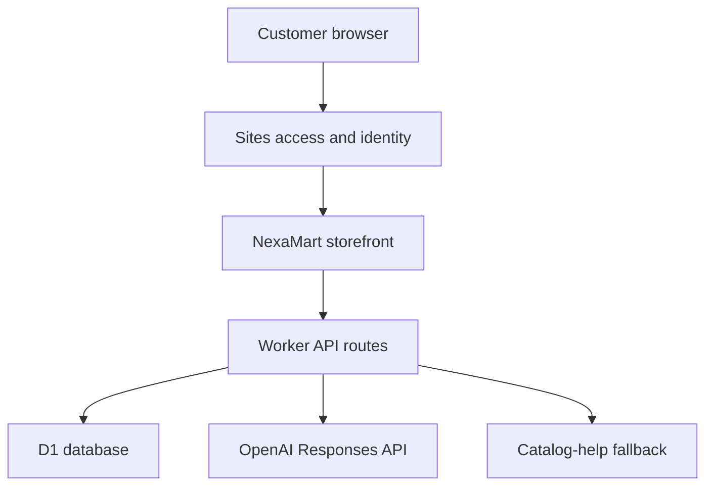

# NexaMart

**NexaMart is an Amazon-inspired, full-stack ecommerce demo with a responsive storefront, persistent shopping data, inventory administration, and a catalog-aware shopping assistant.** It has its own branding and uses sample products to demonstrate the journey from browsing to order placement.

- **Website:** [NexaMart](https://nexamart.psatyasaiganesh.chatgpt.site) — private access; publishing source code does not make the website public.
- **Repository:** [psatyasaiganesh-oss/Nexamart](https://github.com/psatyasaiganesh-oss/Nexamart).
- **Currency:** Indian rupees (INR).
- **Payments and fulfilment:** demonstration only; no money is charged and no products are shipped.

## Project purpose

The project demonstrates how a frontend and backend work together in an ecommerce application: product discovery, account-based shopping, server-side validation, persistent orders, stock updates, and an assistant that can use the store’s current data. It is suitable as a portfolio project, a learning environment, or a starting point for a more specialized store.

This is a single-store application. It does not implement Amazon’s marketplace, seller onboarding, logistics network, or payment infrastructure.

## Main features

### Product discovery

- 20 seeded sample products across Electronics, Men, Women, and Accessories.
- Product photos bundled with the application.
- Search across names, descriptions, and categories.
- Category filters, price thresholds, and an in-stock filter.
- Sorting by featured order, ascending/descending price, and sample rating.
- Product details with description, current price, comparison price, sample ratings, and stock.
- Responsive layouts for desktop and mobile, with accessible controls and keyboard support.

Prices, comparison prices, ratings, and product data are samples, not verified retail offers. “Featured” retains catalog order. Product images and descriptions originate from [Fake Store API](https://fakestoreapi.com/).

### Customer accounts and shopping

- Sign in with ChatGPT through the Sites platform.
- Account information derived from verified server-side identity.
- Persistent cart and saved favourites, scoped to each customer.
- Add items, increase/decrease quantity, and remove cart lines.
- Quantities checked against available inventory and limited to 20 per product.
- Delivery-address form with name, street, city, 10-digit phone, and 6-digit PIN validation.
- Server-calculated order totals.
- Demo checkout that saves orders and deducts stock.
- Customer-specific order history and product snapshots.

### Store administration

The administrator can:

- View the catalog and available units.
- Edit current product prices and stock quantities.
- View store demo orders.
- Change an order’s status through `Placed`, `Processing`, `Shipped`, and `Delivered`.

Product creation/deletion, seller accounts, automated fulfilment, and refunds are not implemented. Order-status updates are manual and do not notify a carrier.

### Nexa shopping assistant

The **Ask Nexa** button opens a chat panel. It supports:

- Recommendations based on product interests and a budget in rupees.
- Comparisons of catalog products.
- Current price and stock information from the database.
- Questions about demo delivery, checkout, cart, and sign-in.
- Summaries of the signed-in customer’s latest five orders.
- Product recommendation cards that open the existing product-detail view.
- Suggested opening questions, loading/error states, and a clear-chat control.

The assistant has two explicitly labelled modes:

| Mode | When it runs | Behaviour |
| --- | --- | --- |
| AI | A server-side OpenAI key is configured and the provider responds successfully | Uses the OpenAI Responses API with current catalog records and the customer’s minimal order summaries. |
| Catalog help | No AI key is configured, or the provider fails | Uses deterministic product matching and store facts. This mode is not presented as live AI. |

The AI integration is implemented, but live AI requires a separately configured OpenAI API key and account access. ChatGPT sign-in alone does not supply API credentials. The default model is `gpt-4.1-mini`; `OPENAI_MODEL` can override it with a compatible Responses/Structured Outputs model available to your account.

Chat is temporary: it remains in the open application session but is not saved to the database and is lost on reload. The assistant does not add items to carts, create orders, change inventory, or process payments. Customers complete those actions through the existing controls.

## Technology stack

| Layer | Technology | Responsibility |
| --- | --- | --- |
| Frontend | React 19 and TypeScript | Storefront, shopping state, forms, and chat panel. |
| Application framework | Vinext, Next-compatible App Router, and Vite | Page rendering, API routes, and Worker builds. |
| Styling | Tailwind CSS and custom CSS | Brand styling, responsive layouts, and interaction states. |
| UI primitives | Shadcn components and Radix UI | Dialogs, sheets, selects, and checkboxes. |
| Icons and feedback | Lucide React and Sonner | Icons and notifications. |
| Backend runtime | Cloudflare Workers | Store and assistant endpoints. |
| Database | Cloudflare D1 / SQLite | Products, customers, carts, favourites, orders, and chat usage limits. |
| Schema management | Drizzle ORM / Drizzle Kit | Schema definitions and versioned SQL migrations. |
| Authentication and hosting | Sites | Verified identity, private website access, and deployment. |
| AI provider | OpenAI Responses API | Optional conversational shopping assistance. |
| Dependency management | pnpm and the committed lockfile | Reproducible dependency installation. |

There is no separate Express server or MongoDB database. Product images are static assets; R2 is not currently used.

## Architecture



The browser calls same-origin API routes. Store endpoints validate identity, inputs, prices, quantities, and administrator permissions before writing to D1. The assistant endpoint reads current store data and either requests an AI answer or returns catalog help. Keys stay on the backend.

## Shopping and checkout flow

1. Browse, search, or filter products.
2. Sign in to save products or add them to your persistent cart.
3. Review quantities and totals in Cart.
4. Enter delivery details and submit a demo order.
5. The backend calculates the total from current database prices.
6. An atomic database batch saves the order and item snapshots, deducts stock, and clears the cart.
7. The order appears in the customer’s history and administrator order view.

A checkout request carries a unique idempotency key. Repeating a completed request returns the existing order rather than creating another one. Stock constraints prevent negative inventory; a failed batch rolls back its changes.

### Demo delivery rules

| Cart subtotal | Delivery fee |
| --- | --- |
| Below ₹999 | ₹99 |
| ₹999 or more | Free |

Taxes, coupons, payment fees, and real carrier rates are not calculated. These delivery amounts exist only to demonstrate checkout totals.

## Project structure

| Path | Purpose |
| --- | --- |
| `app/page.tsx` | Main storefront entry page. |
| `app/store.tsx` | Product browsing, cart, wishlist, checkout, accounts, orders, and administrator UI. |
| `app/shopping-assistant.tsx` | Nexa chat panel and recommendation cards. |
| `app/globals.css` | Shared theme and product-specific styles. |
| `app/api/store/route.ts` | Store read endpoint and shopping/admin mutations. |
| `app/api/assistant/route.ts` | Assistant configuration status and chat endpoint. |
| `app/chatgpt-auth.ts` | Server-side Sites authentication helpers. |
| `lib/catalog.ts` | Initial sample catalog and shared product type. |
| `lib/db.ts` | Raw D1 binding access helper. |
| `lib/shopping-assistant.ts` | Message validation, product matching, catalog answers, and model-output extraction. |
| `db/schema.ts` | Drizzle database schema. |
| `drizzle/` | SQL migrations and schema metadata. |
| `public/products/` | Bundled sample product images. |
| `components/ui/` | Reusable UI primitives. |
| `tests/assistant.test.cjs` | Assistant integration tests with SQLite and a mocked provider. |
| `build/` and `scripts/` | Framework, Worker, and Sites build support. |
| `.openai/hosting.json` | Existing Site identity and logical D1 binding declaration. |
| `.env.example` | Safe template for local AI configuration. |

The `examples/` directory contains starter examples; those are not the storefront’s active routes.

## Database schema

| Table | Main data | Usage |
| --- | --- | --- |
| `products` | Name, description, category, prices, stock, rating, image, tag | Current catalog and inventory. |
| `users` | Verified user ID, email, display name | Customer profile records. |
| `settings` | Key/value settings | Stores the administrator’s user ID. |
| `cart` | User ID, product ID, quantity | Persistent customer cart; composite primary key prevents duplicate lines. |
| `wishlist` | User ID, product ID | Persistent saved products. |
| `orders` | Order ID, customer ID, address, total, status, creation time | Durable demo order records. |
| `order_items` | Order/product IDs, product name, image, price, quantity | Product snapshots at checkout. |
| `assistant_usage` | User ID, hourly window, request count | Atomic per-customer assistant rate limits. |

`products` enforces positive prices and nonnegative stock. An index on `orders.user_id` supports customer-order lookup. Application code enforces ownership and references; the schema does not currently declare foreign-key relationships.

Missing initial sample products are inserted with `INSERT OR IGNORE`. Loading the store does not overwrite saved prices or stock. Migrations define schema only; sample data is initialized separately by the store endpoint.

## Authentication and administrator setup

The hosted application relies on verified identity forwarded by Sites, using the bundled ChatGPT authentication helpers. Browser sign-in and sign-out are owned by the platform.

**The current deployment is owner-private. Its first authenticated customer becomes the administrator once.** That identifier is persisted in `settings`; later customers cannot claim administrator access. The UI flag is only for presentation: backend endpoints check administrator identity independently.

Before broadening access or launching publicly, provision the intended owner first and replace first-visitor administrator provisioning with an explicit administrator allowlist or another deliberate role-management workflow. Do not expose the Worker directly while accepting client-supplied identity headers as trusted authentication.

Customer carts, favourites, and order history are selected by the authenticated user ID. A model prompt or message cannot choose another customer’s identity.

## Local setup

### Requirements

- Node.js 22.13 or newer; a current Node 22 release is recommended for the SQLite test runner.
- pnpm compatible with the committed lockfile.
- Git.
- Sites access for the existing private deployment and hosted authentication.
- An OpenAI API account/key only if enabling live AI.

On Windows, WSL is useful for scripts that invoke Bash. Preserve the existing lockfile rather than switching package managers as part of setup.

### Clone and install

```bash
git clone https://github.com/psatyasaiganesh-oss/Nexamart.git
cd Nexamart
pnpm install --frozen-lockfile
```

Copy `.env.example` to `.env` using your editor or file manager. Leave the key blank to run catalog-help mode. To enable local AI, set:

```dotenv
OPENAI_API_KEY=your-server-side-key
OPENAI_MODEL=gpt-4.1-mini
```

`.env` is ignored by Git; `.env.example` contains no real credentials. Do not prefix the key with `NEXT_PUBLIC_` or `VITE_`, include it in frontend code, or paste it into the README.

### Prepare the local database

The repository already includes its generated migrations. Build to generate the local Worker configuration:

```bash
pnpm run build
```

Apply pending SQL migrations to the local D1 database in order:

```bash
node --import ./scripts/sites-env.mjs ./node_modules/wrangler/bin/wrangler.js d1 execute DB --local --config dist/server/wrangler.json --persist-to .wrangler/state --file drizzle/0000_sleepy_puppet_master.sql
node --import ./scripts/sites-env.mjs ./node_modules/wrangler/bin/wrangler.js d1 execute DB --local --config dist/server/wrangler.json --persist-to .wrangler/state --file drizzle/0001_hard_magma.sql
```

Do not replay a migration already applied to that local database. These commands change local state only. Sites applies production migrations separately during deployment.

### Start development

```bash
pnpm run dev
```

Use the address printed by the development server. Local development does not automatically simulate hosted ChatGPT sign-in. Browsing can render locally, while protected shopping/assistant operations require the verified identity provided by the hosted environment. Integration tests provide mocked identity for development checks; do not add a production authentication bypass.

### Available commands

| Command | Purpose |
| --- | --- |
| `pnpm run dev` | Start the development server. |
| `pnpm run build` | Generate the Worker-compatible production build. |
| `pnpm run start` | Preview the built Worker locally through Wrangler. |
| `pnpm run db:generate` | Generate a new migration after editing `db/schema.ts`. |
| `pnpm exec tsc --noEmit` | Type-check the project. |
| `node --test tests/assistant.test.cjs` | Run assistant integration tests. |

## Environment configuration

| Variable | Required? | Purpose |
| --- | --- | --- |
| `OPENAI_API_KEY` | Only for live AI | Server-side secret used by the assistant endpoint. |
| `OPENAI_MODEL` | Optional | Compatible model ID; defaults to `gpt-4.1-mini`. |
| `DB` | Required binding | D1 database supplied through the Worker environment. This is a binding, not a string value to put in `.env`. |

Production runtime values are separate from local `.env`. Configure the key as a secret in Sites, configure the model if needed, and redeploy. The hosting manifest declares logical resources and the existing Site identity; it must never hold secrets.

For a fork with its own deployment, create/register a new Site through the Sites workflow instead of reusing this project’s ID.

## API overview

All store-changing requests use JSON. Successful writes return `{ "ok": true }`, with an `orderId` for checkout. Errors return an `error` message and an appropriate HTTP status.

### `GET /api/store`

Returns the catalog plus the current customer’s profile, cart, wishlist, and orders. Anonymous reads omit customer data. Administrators additionally receive the store’s order summaries.

### `POST /api/store`

| `action` | Fields | Behaviour |
| --- | --- | --- |
| `cart` | `productId`, `quantity` | Create/update a cart line; quantity `0` removes it. |
| `wishlist` | `productId`, `saved` | Add/remove a saved product. |
| `checkout` | `address`, `key` | Validate details, save a demo order, update stock, and clear the cart. |
| `inventory` | `productId`, `price`, `stock` | Administrator-only price and stock update. |
| `orderStatus` | `orderId`, `status` | Administrator-only order-status update. |

`address` requires `name`, `phone`, `line`, `city`, and `pin`. `key` is a unique checkout identifier, normally a UUID generated by the frontend. Backend prices are authoritative; clients do not send a checkout total.

### `GET /api/assistant`

Returns assistant configuration status without exposing a key:

```json
{ "configured": false, "mode": "catalog" }
```

### `POST /api/assistant`

Requires a signed-in customer. Example request:

```json
{
  "messages": [
    { "role": "user", "content": "Find electronics under ₹10,000" }
  ]
}
```

Successful replies contain:

- `reply`: answer text.
- `products`: zero to three validated, current product records for recommendation cards.
- `mode`: `ai` or `catalog`.
- `notice`: a fallback/configuration explanation when applicable.

The endpoint accepts 1–12 messages with `user` or `assistant` roles only, up to 2,000 characters each and 12,000 characters total. The visible composer limits each question to 1,000 characters. Requests are size-bounded, same-origin checked when an Origin header is present, and limited per customer per hour: 20 when AI is configured, otherwise 60.

## AI data flow and boundaries

1. Verify the signed-in customer and validate the conversation.
2. Atomically reserve an assistant request within the hourly limit.
3. Read current catalog records and the customer’s latest five minimal order summaries.
4. If configured, call the OpenAI Responses API with a strict JSON response schema and `store: false`.
5. Validate model output and recommended product IDs; unavailable and over-budget cards are filtered out.
6. Return the reply and product cards, or clearly labelled catalog help if the provider fails.

Order addresses, phone numbers, and customer email are not intentionally included in model context. Customer-entered chat text is sent to the provider in AI mode, so users should avoid entering unnecessary personal data. The key is used only in the backend Authorization header. The endpoint has a 25-second provider timeout, bounded input/output, and no mutation tools. Product descriptions and messages are treated as untrusted data in the model instructions.

`store: false` disables response storage through this API option; it is not a claim that all provider retention policies are disabled. See [OpenAI data controls](https://developers.openai.com/api/docs/guides/your-data).

Relevant implementation documentation: [Text generation](https://developers.openai.com/api/docs/guides/text), [Structured Outputs](https://developers.openai.com/api/docs/guides/structured-outputs), and [GPT-4.1 mini](https://developers.openai.com/api/docs/models/gpt-4.1-mini).

## Validation

Assistant tests exercise:

- Budget-based recommendations, follow-up budgets, comparisons, and unavailable-product handling.
- Demo-delivery and checkout explanations.
- Authentication, origin, message-role, and size validation.
- Explicit catalog-help mode when no key exists.
- Isolation of customer order information.
- Mocked AI requests, structured responses, and product-ID validation.
- Provider failures and malformed-output fallback.
- Atomic hourly limits, per-customer isolation, and window reset.

The test suite mocks OpenAI; it does not make paid API calls. A real provider smoke test requires configured credentials. Browser QA and live AI verification must be completed in an environment where those capabilities are available before treating the project as production-ready.

## Deployment

The existing application uses Sites with a Cloudflare Worker and a D1 binding named `DB`. Preserve `.openai/hosting.json`, generated migrations, and the framework build support when updating it.

For the existing Site:

1. Pull the current source and make changes.
2. Generate/inspect a new migration if the schema changes; do not rewrite applied migrations.
3. Type-check, run relevant tests, and build the Worker output.
4. Configure any needed runtime secrets separately.
5. Publish the exact built source through Sites and confirm deployment success.
6. Preserve the private audience unless the owner chooses to change it.

Updating GitHub alone does not automatically redeploy this Site. The repository is public; the hosted application’s audience is controlled separately.

## Current limitations and production work

This is a functional demonstration, not a commercially complete ecommerce platform. A production launch would need work appropriate to the intended business, including:

- Real payment-provider integration, verified payment events, refunds, and settlement handling.
- Deliberate administrator provisioning and public-customer authentication/access policy.
- Real product data, image permissions, tax rules, shipping integrations, and inventory operations.
- Order notifications, cancellation/return workflows, and operational support.
- Additional end-to-end, concurrency, accessibility, and live-provider testing.
- Privacy policies, customer-data lifecycle, monitoring, backups, and recovery procedures.

No payment gateway, email/SMS service, shipment booking, seller marketplace, product uploads, coupon engine, or automated tax calculation is currently configured.

## Data attribution and licensing

Sample product imagery/descriptions come from [Fake Store API](https://fakestoreapi.com/); names, prices, and presentation were adapted for the demo. Confirm the relevant rights or replace sample assets before commercial use. Third-party UI/build assets include their own licence notices in `vendor/` and `build/`. The repository does not currently declare a separate project-wide licence.
